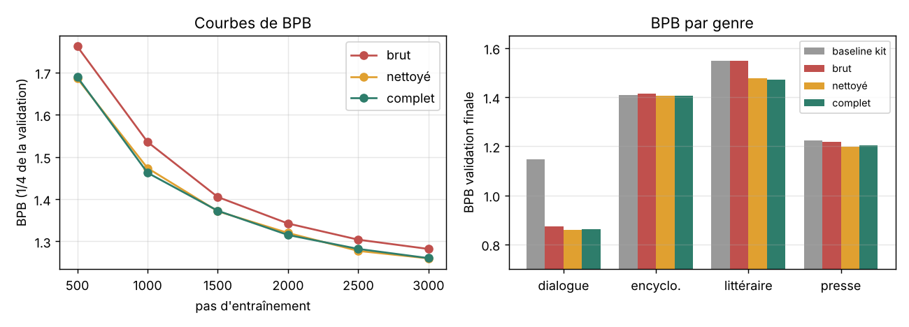

# Rapport d'ablation : qu'est-ce qui compte vraiment dans mes données ?

Saifeddine Sayah · Piscine I Lab « Feed the Beast » · 16 novembre 2026

## 1. Ce que j'ai testé

Je voulais savoir quelles étapes de mon pipeline améliorent vraiment le modèle. J'ai donc entraîné
trois fois le modèle officiel du kit (10,17M paramètres, 100M tokens, graine 1337, GPU T4), en
gardant exactement le même mélange de sources et en ne changeant que le traitement :

| Variante | Traitement |
|---|---|
| Brut | les données telles que je les ai collectées |
| Nettoyé | + encodage réparé (ftfy), filtre de langue (fastText, seuil 0,65), boilerplate web retiré, licences Gutenberg retirées et paragraphes recollés |
| Complet | + déduplication exacte et MinHash (seuil 0,8), filtres qualité Gopher sur le web, masquage des données personnelles |

Les trois font 443 Mo avec les mêmes proportions : Wikipédia 25 %, Gutenberg 21 %, Assemblée
nationale 24 %, presse (FineWeb-2 filtré par domaine) 15 %, web 7 %, Common Crawl 5 %, Molière
1,4 %. Chaque variante a son propre tokenizer de 8 192 tokens. J'ai aussi gardé comme point de
départ la baseline du kit (70 % FineWeb-2, 25 % Wikipédia, 5 % Molière). Tous les chiffres sont
des BPB sur la validation publique (230 documents, 4 genres à parts égales).

## 2. Résultats

| Dataset | BPB | Dialogue | Encyclo. | Littéraire | Presse | Octets/token |
|---|---|---|---|---|---|---|
| Baseline du kit | 1,332 | 1,146 | 1,410 | 1,549 | 1,224 | 3,77 |
| Brut | 1,262 | 0,872 | 1,415 | 1,549 | 1,218 | 3,56 |
| Nettoyé | 1,234 | 0,859 | 1,406 | 1,478 | 1,197 | – |
| Complet (soumis) | 1,234 | 0,861 | 1,406 | 1,473 | 1,203 | 3,77 |

## 3. Ce que j'en retiens

Le choix des sources a eu bien plus d'effet que tout le reste : −0,07 entre la baseline et mon
mélange brut. Presque tout vient du dialogue, qui passe de 1,15 à 0,87. La validation contient
des débats parlementaires, donc ajouter les comptes rendus de l'Assemblée nationale a fait plus
que n'importe quel filtre. Avec le recul, j'aurais dû commencer par regarder la validation genre
par genre avant de penser aux filtres.

Le nettoyage apporte encore −0,03, presque entièrement sur la littérature (1,549 → 1,478). Les
livres Gutenberg bruts ont une licence en anglais et des retours à la ligne tous les 70
caractères, alors que la validation met un paragraphe par ligne. Le nettoyage améliore aussi la
compression : sur les données brutes, le tokenizer ne fait que 3,56 octets par token (contre 3,77),
parce que 88 % du Common Crawl n'est pas en français. Le modèle lit donc environ 6 % de texte en
moins pour le même budget, et sa courbe reste au-dessus des autres pendant tout l'entraînement.

La déduplication, les filtres qualité et le masquage n'ont rien changé au BPB (+0,0004, ce qui est
du bruit). Je m'attendais à mieux. Je pense que c'est parce que mes plus grosses sources
(Wikipédia, Assemblée, presse) étaient déjà propres, et que là où la dédup agit vraiment (214 livres
Gutenberg sur 550 étaient des doublons exacts), il restait assez de livres pour remplir la part de
Gutenberg. Je garde quand même ces étapes : elles retirent environ 1 400 emails et 1 700 numéros
de téléphone, et elles compteraient beaucoup plus avec davantage de web brut.

## 4. Ce qui n'a pas marché

- **Le Common Crawl.** Au premier essai, le serveur m'a renvoyé une page d'erreur au lieu du
  fichier, et j'ai dû ajouter des réessais. Je n'ai traité que 2 fichiers WET : sur 400 Mo, il
  reste 7 Mo de français. C'est trop peu, et cette part est répétée environ 3 fois dans le mélange.
- **Le filtre de langue ne suffit pas.** Sur 100 extraits annotés à la main, il a 100 % de
  précision et de rappel. Mais beaucoup de pages françaises gardées sont des boutiques, des menus ou
  des annuaires, et mes filtres Gopher n'en ont retiré qu'environ 1 300.
- **Le serveur de l'Assemblée coupait les téléchargements** en plein milieu. J'ai fini par écrire un
  téléchargement qui reprend là où il s'est arrêté.
- **Je n'ai pas pu tester mon mélange v2** (plus de Gutenberg et de presse, presque plus de Common
  Crawl), qui visait la littérature, mon genre le plus faible. J'ai perdu deux sessions Colab, puis
  je n'avais plus de GPU gratuit. Il est prêt (`--mix v2`) mais pas évalué.
- **Contamination** : 4 débats de la validation sur 230 dépassent 10 % de 13-grammes communs avec
  mes données (11 à 15 %). Les séances après le 1er septembre 2026 sont exclues ; je pense que ce
  sont les formules de procédure répétées dans chaque séance (« La parole est à… »).

Enfin, chaque variante n'a été entraînée qu'une fois : un écart de ±0,005 n'est pas significatif.
